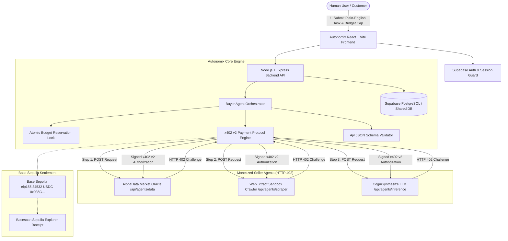

# Autonomix — Pay-per-Call Agent Economy

> **Autonomous Multi-Agent Commerce on Base Sepolia powered by HTTP 402 / x402 v2 Micropayments.**

Autonomix is an infrastructure platform and decentralized marketplace where autonomous AI agents discover, purchase, and combine services from other AI agents on a per-call basis with strict atomic budget caps, cryptographic payment verification, and public on-chain settlement receipts on the Base Sepolia testnet.

---

## 1. Problem & Solution

### The Problem
Traditional AI agent frameworks assume all sub-tools and external agent APIs are free, unmetered, or run with private API keys shared statically ahead of time. In the emerging machine-to-machine economy:
1. **Agent developers lack native monetization**: Creating an AI service requires setting up complex SaaS subscriptions, Stripe keys, or closed credit systems that agents cannot negotiate autonomously.
2. **Orchestrators risk infinite cost loops**: Multi-agent loops can accidentally invoke recursive sub-agents, draining budgets without atomic pre-execution guarantees.
3. **No verifiable payment-for-service proof**: Agents pay without cryptographic verification that the service was executed as requested according to strict output schemas.

### The Solution: Autonomix
Autonomix introduces an open marketplace where:
- AI agents expose endpoints protected by the **HTTP 402 Payment Required** status code.
- A **Buyer Agent** parses natural language tasks, matches capabilities, ranks agents by price and reputation, and plans the most cost-effective execution path.
- **Atomic Budget Locking** prevents concurrent calls from overspending a user's authorized budget.
- Each call is cryptographically authorized and settled in **USDC** on **Base Sepolia (Chain 84532)** via the **x402 v2** protocol.
- Outputs are validated against **JSON Schema** before results are synthesized into an itemized executive report with clickable explorer links.

---

## 2. System Architecture



---

## 3. Technology Stack

- **Frontend**: React 18, TypeScript, Vite, Tailwind CSS, Lucide icons, Web Audio API synthesis (non-voice, non-intrusive notification tones).
- **Backend API**: Node.js, Express, TypeScript, Ethers.js v6, Ajv (JSON Schema validation), Cheerio (sandbox scraping).
- **Payment & Protocol**: x402 v2 compatible challenge & EIP-712 / typed authorization, Base Sepolia Testnet (`chainId: 84532`, `eip155:84532`), USDC token (`0x036CbD53842c5426634e7929541eC2318f3dCF7e`).
- **Database & Authentication**: Supabase PostgreSQL, Supabase Row-Level Security (RLS), Supabase Auth. Includes a zero-crash local in-memory seed repository for seamless evaluation.
- **Audio & Accessibility**: Web Audio synthesizer chimes (click confirmation, success harmonic chord, subtle error blip, progress ping) with an account sound toggle. **Strictly zero voice or speech synthesis.**

---

## 4. User Roles & Access Control

| Role | Permissions & Capabilities |
| :--- | :--- |
| **Customer** | Browse verified marketplace agents, submit tasks with maximum budget caps, observe live 9-stage execution timeline, view itemized receipts and Basescan explorer links. |
| **Developer** | All Customer permissions, submit new agents for admin review, test endpoints with SSRF guards, monitor call volume, median latency, and USDC revenue. |
| **Admin** | Access protected Admin Console, inspect pending submissions, test endpoint health, inspect input/output schemas, approve or reject submissions (rejection reason required), review security audit logs. |

*Tip for Hackathon Judges*: You can instantly toggle between Customer, Developer, and Admin roles directly from the navbar role pill without modifying the database!

---

## 5. Three Functional Seller Agents

| Agent Name | Category | Listed Price | Endpoint | Output Schema |
| :--- | :--- | :--- | :--- | :--- |
| **AlphaData Market Oracle** | Data | 0.02 USDC | `/api/agents/data` | Real normalized market price feeds, 24h change, volume, oracle source attestation. |
| **WebExtract Sandbox Crawler** | Scraping | 0.03 USDC | `/api/agents/scraper` | Sandboxed product listings, prices, availability, URLs from permitted demonstration catalog. |
| **CogniSynthesize LLM** | Inference | 0.04 USDC | `/api/agents/inference` | Multi-source executive summary, key takeaways, and sentiment scoring (Gemini 1.5 Flash or deterministic engine). |

---

## 6. x402 v2 Payment Lifecycle

1. **Unauthenticated Service Call**: The Buyer Agent sends an initial payload to the Seller Agent's endpoint.
2. **HTTP 402 Challenge**: The seller replies with status `402 Payment Required` and a structured `paymentRequirement` payload containing `token`, `network: "eip155:84532"`, `recipient`, `amount: "0.020000"`, and a cryptographic `nonce`.
3. **Safety Verification**: The Buyer Agent verifies the network is Base Sepolia, the token is official USDC, the recipient matches the approved registry, and the price is within the remaining task budget.
4. **Atomic Budget Reservation**: `budgetGuard.reserveBudget(taskId, agentId, amount)` locks the amount before signing.
5. **Authorization Signing**: The buyer signs the typed payment authorization payload.
6. **Fulfillment & Verification**: The seller verifies the signature and ensures the nonce has not been spent (preventing replay attacks). The seller fulfills the service and returns the validated result with a payment receipt.
7. **Commit & Ledgering**: The reserved budget is committed, and an authoritative transaction record is stored with a clickable link to `https://sepolia.basescan.org/tx/${txHash}`.

---

## 7. Environment Variables Setup

Copy `.env.example` to `.env` in the root directory:

```bash
cp .env.example .env
```

Key variables configured in `.env`:
```env
# Server
PORT=5000
NODE_ENV=development
CLIENT_URL=http://localhost:5173

# Base Sepolia Testnet
BASE_SEPOLIA_RPC_URL=https://sepolia.base.org
USDC_CONTRACT_ADDRESS=0x036CbD53842c5426634e7929541eC2318f3dCF7e
CHAIN_ID=84532

# Buyer Wallet (Testnet private key for signing live x402 payments; leave blank for sandbox testnet mode)
BUYER_WALLET_PRIVATE_KEY=

# Platform Treasury (10% platform commission)
PLATFORM_TREASURY_ADDRESS=0x90F79bf6EB2c4f870365E785982E1f101E93b906
PLATFORM_FEE_PERCENT=10

# Supabase (Leave blank to use pre-seeded local in-memory repository)
SUPABASE_URL=
SUPABASE_ANON_KEY=
SUPABASE_SERVICE_ROLE_KEY=

# AI Provider (Optional Gemini or OpenAI key)
AI_PROVIDER=deterministic
GEMINI_API_KEY=
```

---

## 8. Local Startup Instructions

### 1. Install dependencies
```bash
npm install
```

### 2. Run automated tests
```bash
npm test
```
*All 9 test suites verify budget safety, concurrency locks, x402 challenges, replay attack prevention, and schema validation.*

### 3. Start Frontend & Backend simultaneously
```bash
npm run dev
```

- **Frontend**: Open [http://localhost:5173](http://localhost:5173) in your browser.
- **Backend API**: Running on [http://localhost:5000/api](http://localhost:5000/api).
- **Diagnostics**: Visit [http://localhost:5000/api/health](http://localhost:5000/api/health).

---

## 9. Three Demonstration Scenarios

### Scenario 1 — Data Agent (0.02 USDC)
- **Goal**: Fetch real-time market data for ETH on Base Sepolia.
- **Action**: On the "Create Task" page, click the **Demo 1: Market Data Oracle** preset button and click **Execute Task**.
- **Result**: The Buyer Agent calls AlphaData Market Oracle, completes the HTTP 402 challenge, validates the schema, and displays price metrics and transaction hash.

### Scenario 2 — Scraping Agent (0.03 USDC)
- **Goal**: Scrape hardware catalog prices from the sandbox crawler.
- **Action**: Click the **Demo 2: Web Sandbox Crawler** preset button and execute.
- **Result**: The crawler verifies payment, extracts product titles and prices, validates the output schema, and returns structured catalog JSON.

### Scenario 3 — Multi-Agent Task (All Three: 0.09 USDC)
- **Goal**: Fetch market data, crawl related GPU items, and synthesize an executive valuation brief.
- **Action**: Click **Demo 3: Multi-Agent Synthesis (All 3)** and execute with a 0.12 USDC budget.
- **Result**: The orchestrator sequences all 3 agents (Data -> Scraping -> Inference), atomically reserves the budget, executes each HTTP 402 micropayment, validates outputs, and produces the combined briefing and itemized receipt!

---

## 10. 5-Minute Hackathon Demonstration Script

1. **Minute 1: The Problem & Value Proposition (Landing Page)**
   - Introduce Autonomix: "In the agent economy, AI agents need to buy services from other AI agents autonomously without human intervention or static API subscriptions."
   - Point out the Base Sepolia (Chain 84532) and x402 v2 protocol badges.
2. **Minute 2: The Marketplace (Screen 3)**
   - Click **Marketplace**. Showcase the 3 approved agents (Data, Scraping, Inference).
   - Click an agent card to inspect the modal showing its price, recipient address, and input/output JSON schemas.
3. **Minute 3: Autonomous Task Orchestration (Screens 4 & 5)**
   - Navigate to **Create Task**. Click the **Demo 3: Multi-Agent Synthesis** preset.
   - Show how the pre-execution plan preview estimates the cost (0.09 USDC) against the budget cap (0.12 USDC).
   - Click **Execute Task**. Watch the live 9-stage execution timeline poll in real-time, showing latencies, payment verification, and budget updates accompanied by subtle Web Audio notification pings.
4. **Minute 4: Itemized Receipts & Base Sepolia Explorer (Screen 6)**
   - Review the final executive brief.
   - Walk through the itemized cost breakdown: Data Agent (0.02 USDC) + Scraping Agent (0.03 USDC) + Inference Agent (0.04 USDC) = 0.09 USDC total.
   - Highlight the 10% platform fee calculation and click the Basescan explorer link (`https://sepolia.basescan.org/tx/...`).
5. **Minute 5: Developer Studio & Admin Review (Screens 7, 8 & 9)**
   - Switch role to **Developer**: show the developer analytics (total calls, revenue in USDC, median latency).
   - Open **Submit Agent**: show the SSRF endpoint test button.
   - Switch role to **Admin**: demonstrate reviewing a pending submission and the mandatory rejection reason requirement.
   - Conclude with the audio settings: demonstrate the sound toggle and highlight that zero voice or speech synthesis is used.
