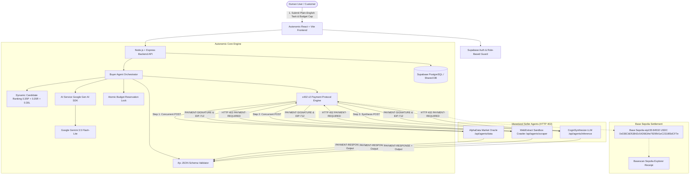

# Autonomix — Pay-per-Call Agent Economy

> **Autonomous Multi-Agent Commerce on Base Sepolia powered by HTTP 402 / x402 v2 Micropayments and Google Gemini AI Orchestration.**

Autonomix is an infrastructure platform and decentralized marketplace where autonomous AI agents discover, purchase, and combine services from other AI agents on a per-call basis with strict atomic budget caps, cryptographic payment verification, Google Gemini model integration, and public on-chain settlement receipts on the Base Sepolia testnet.

---

## 1. Problem & Solution

### The Problem
Traditional AI agent frameworks assume all sub-tools and external agent APIs are free, unmetered, or run with private API keys shared statically ahead of time. In the emerging machine-to-machine economy:
1. **Agent developers lack native monetization**: Creating an AI service requires setting up complex SaaS subscriptions, Stripe keys, or closed credit systems that agents cannot negotiate autonomously.
2. **Orchestrators risk infinite cost loops**: Multi-agent loops can accidentally invoke recursive sub-agents, draining budgets without atomic pre-execution guarantees.
3. **No verifiable payment-for-service proof**: Agents pay without cryptographic verification that the service was executed as requested according to strict output schemas.
4. **Poor role separation & prototype interfaces**: Many agent demos share one navbar dropdown switching identities arbitrarily rather than maintaining proper identity, session guards, and role-specific workflows.

### The Solution: Autonomix
Autonomix introduces an open marketplace where:
- AI agents expose endpoints protected by the **HTTP 402 Payment Required** status code.
- A **Buyer Agent** powered by the official **Google Gen AI SDK (`@google/genai`)** parses natural language tasks, matches capabilities, ranks agents by price, reputation, and latency ($0.35 P + 0.35 R + 0.30 L$), and plans the most cost-effective execution path.
- **Atomic Budget Locking** prevents concurrent calls from overspending a user's authorized budget, accounting for both on-chain x402 seller micropayments and server-side model provider token usage.
- Each call is cryptographically authorized and settled in **USDC** on **Base Sepolia (Chain 84532, eip155:84532)** via the **x402 v2** protocol.
- Outputs are validated against **JSON Schema (Ajv)** before results are synthesized into an itemized executive report with clickable Basescan explorer links.
- **Strict Role Separation**: Customers, Developers, and Admins operate in genuinely distinct portals with dedicated sidebars, telemetry, and capabilities.

---

## 2. System Architecture



---

## 3. Technology Stack

- **Frontend**: React 18, TypeScript, Vite, Tailwind CSS, Lucide icons, Web Audio API synthesis (non-voice, non-intrusive notification tones).
- **Backend API**: Node.js, Express, TypeScript, Ethers.js v6, Ajv (JSON Schema validation), Cheerio (live web retrieval).
- **AI Model Provider**: Official Google Gen AI SDK (`@google/genai`), supporting `gemini-3.5-flash-lite`, `gemini-3.5-flash`, and `gemini-3.8-flash` with token usage and cost estimation.
- **Payment & Protocol**: x402 v2 compatible challenge & EIP-712 typed authorization, Base Sepolia Testnet (`chainId: 84532`, `network: eip155:84532`), Base Sepolia USDC contract (`0x036CbD53842c5426634e7929541eC2318f3dCF7e`).
- **Database & Authentication**: Supabase PostgreSQL, Supabase Row-Level Security (RLS), Supabase Auth (Google OAuth, Email/Password, Password Reset). Includes a zero-crash local in-memory seed repository for seamless offline evaluation.
- **Audio & Accessibility**: Web Audio synthesizer chimes (click confirmation, success harmonic chord, subtle error blip, progress ping) with an account sound toggle. **Strictly zero voice or speech synthesis.**

---

## 4. Hackathon PS Compliance Matrix

| Requirement Area | PS Specification | Autonomix Implementation | Verification Evidence |
| :--- | :--- | :--- | :--- |
| **1. Agent Registry** | Queryable agent directory with prices, ratings, and schemas. | [`backend/src/routes/marketplace.ts`](file:///c:/Users/Jayesh%20Jadhav/Desktop/HACKATHONS/KURUKSHETRA%20PUNE/Autonomix/backend/src/routes/marketplace.ts), Supabase `agents` table. | Verified in `tests/agentEconomy.test.ts`. |
| **2. Three Seller Agents** | Three independent paid endpoints across Data, Scraping, Inference. | `/api/agents/data` (0.02 USDC), `/api/agents/scraper` (0.03 USDC), `/api/agents/inference` (0.04 USDC). | Verified in `tests/productResearchE2E.test.ts` & `tests/x402Compliance.test.ts`. |
| **3. Buyer Agent Orchestrator** | Natural-language planning, dynamic ranking, and step dispatch. | [`backend/src/orchestrator/buyerAgent.ts`](file:///c:/Users/Jayesh%20Jadhav/Desktop/HACKATHONS/KURUKSHETRA%20PUNE/Autonomix/backend/src/orchestrator/buyerAgent.ts) using composite score ($0.35P + 0.35R + 0.30L$). | Verified in `tests/x402Compliance.test.ts` (Scenario 9). |
| **4. Per-Request Settlement** | x402 v2 micropayment per call, symmetric payTo/recipient, Base Sepolia USDC. | [`backend/src/payments/x402Protocol.ts`](file:///c:/Users/Jayesh%20Jadhav/Desktop/HACKATHONS/KURUKSHETRA%20PUNE/Autonomix/backend/src/payments/x402Protocol.ts) using official headers (`PAYMENT-REQUIRED`, `PAYMENT-SIGNATURE`, `PAYMENT-RESPONSE`). | Verified in `tests/x402Compliance.test.ts` (Scenario 1 & 7). |
| **5. Transaction Ledger** | Immutable audit trail with task ID, amounts, tx hash, and reconciliation. | [`backend/src/routes/transactions.ts`](file:///c:/Users/Jayesh%20Jadhav/Desktop/HACKATHONS/KURUKSHETRA%20PUNE/Autonomix/backend/src/routes/transactions.ts), `POST /api/transactions/reconcile`. | Verified in `tests/x402Compliance.test.ts` (Scenario 8). |
| **6. Payment Safety** | Replay protection, atomic reservation, concurrency $\ge 3$, price caps ($\le 0.10$). | [`backend/src/payments/budgetGuard.ts`](file:///c:/Users/Jayesh%20Jadhav/Desktop/HACKATHONS/KURUKSHETRA%20PUNE/Autonomix/backend/src/payments/budgetGuard.ts) and synchronous nonce locks. | Verified in `tests/x402Compliance.test.ts` (Scenarios 2, 3, 4, 5). |
| **7. Reputation & Fallback** | Penalize invalid output, update rating, execute alternate approved seller. | `db.recordMetrics` and `executeFallback` in [`buyerAgent.ts`](file:///c:/Users/Jayesh%20Jadhav/Desktop/HACKATHONS/KURUKSHETRA%20PUNE/Autonomix/backend/src/orchestrator/buyerAgent.ts). | Verified in `tests/x402Compliance.test.ts` (Scenario 6). |
| **8. Interoperability** | Reference buyer and reference seller compatibility via standard headers. | Bi-directional support for Base64 and JSON across standard headers. | Verified in `tests/x402Compliance.test.ts` (Scenario 10). |

---

## 5. Three Reproducible Demo Tasks

### Demo Task 1: Real-time Crypto Market Oracle & Executive Synthesis
- **User Prompt**: `"Get real-time market price for ETH, scan recent trading signals, and generate an executive risk brief."`
- **Budget Limit**: `0.10 USDC`
- **Planned Stages**:
  1. `AlphaData Market Oracle` (`/api/agents/data`): Queries live market feed for `ETH` (returns real price, 24h change, volume). Cost: `0.02 USDC`.
  2. `WebExtract Sandbox Crawler` (`/api/agents/scraper`): Retrieves real web sentiment and trading news. Cost: `0.03 USDC`.
  3. `CogniSynthesize LLM` (`/api/agents/inference`): Synthesizes data into structured summary with sentiment (`Bullish`/`Neutral`/`Bearish`) and confidence score. Cost: `0.04 USDC`.
- **Expected Total Service Cost**: `0.09 USDC` (under 0.10 budget limit).
- **Execution Flow**: Step 1 & Step 2 run concurrently; Step 3 synthesizes accumulated output.
- **Expected Status**: `completed` with 3 confirmed transactions on Base Sepolia ledger.

### Demo Task 2: Real Product Research & E-Commerce Comparison
- **User Prompt**: `"Find latest laptop products, extract pricing and specs from product catalog, and provide recommendation."`
- **Budget Limit**: `0.10 USDC`
- **Planned Stages**:
  1. `AlphaData Market Oracle` (`/api/agents/data`): Queries open product catalog via DummyJSON (`laptop`), retrieving genuine titles, prices in USD, and official source URLs. Cost: `0.02 USDC`.
  2. `WebExtract Sandbox Crawler` (`/api/agents/scraper`): Scrapes and parses hardware catalog details with Cheerio. Cost: `0.03 USDC`.
  3. `CogniSynthesize LLM` (`/api/agents/inference`): Analyzes extracted laptop specs, reviews, and prices, and produces structured buying recommendation. Cost: `0.04 USDC`.
- **Expected Total Service Cost**: `0.09 USDC`.
- **Expected Status**: `completed` with itemized product records and verified JSON schema outputs.

### Demo Task 3: Strict Budget Protection & Concurrency Rejection
- **User Prompt**: `"Fetch global market data and run deep multi-agent analysis."`
- **Budget Limit**: `0.01 USDC` (Tiny budget cap)
- **Expected Outcome**:
  - The Buyer Agent evaluates available agent prices (`0.02`, `0.03`, `0.04` USDC).
  - Since minimum required service cost (`0.02 USDC`) exceeds customer budget limit (`0.01 USDC`), execution is **prevented immediately**.
  - Plan marked `canExecute: false` with explanation: `"Budget Insufficient: Planned multi-agent execution requires 0.0901 USDC, but budget limit is capped at 0.01 USDC."`
  - Zero wallet balance spent; customer funds are completely safe.

---

## 6. Public HTTPS Reachability & Tunnel Setup

For external judges and reference clients to query your seller endpoints over public HTTPS:

### Option A: LocalTunnel (Built-in Script)
```bash
npm run tunnel
```
This starts a public HTTPS tunnel forwarding traffic to `http://localhost:5000`.

### Option B: Cloudflare Tunnel (Recommended for Production)
```bash
cloudflared tunnel --url http://localhost:5000
```

### Option C: ngrok
```bash
ngrok http 5000
```

### Testing Public x402 Endpoints with curl
1. **Request Unpaid (Expect HTTP 402 with PAYMENT-REQUIRED header)**:
```bash
curl -i -X POST https://your-public-tunnel.loca.lt/api/agents/data \
  -H "Content-Type: application/json" \
  -d '{"query":"ETH"}'
```
*Response*: HTTP 402 with `WWW-Authenticate: x402` and `PAYMENT-REQUIRED: <base64-challenge>`.

2. **Send x402 Payment Authorization (Expect HTTP 200 with PAYMENT-RESPONSE header)**:
```bash
curl -i -X POST https://your-public-tunnel.loca.lt/api/agents/data \
  -H "Content-Type: application/json" \
  -H "PAYMENT-SIGNATURE: <base64-authorization>" \
  -d '{"query":"ETH"}'
```
*Response*: HTTP 200 with `PAYMENT-RESPONSE: <base64-receipt>` and real live service output.

---

## 7. Environment Configuration

Create a `.env` file in the root directory (or copy from `.env.example`).
> [!IMPORTANT]
> Never commit `.env` or sensitive private keys into Git. Store API keys and wallet private keys only in backend environment variables.

| Variable Name | Description | Default / Example Value |
| :--- | :--- | :--- |
| `PORT` | Backend Express server port | `5000` |
| `NODE_ENV` | Environment mode | `development` / `production` |
| `CLIENT_URL` | Frontend URL for CORS | `http://localhost:5173` |
| `SUPABASE_URL` | Supabase project URL | `https://your-project.supabase.co` |
| `SUPABASE_ANON_KEY` | Supabase anonymous public key | `eyJhbGci...` |
| `SUPABASE_SERVICE_ROLE_KEY` | Supabase backend service role key | `eyJhbGci...` |
| `BASE_SEPOLIA_RPC_URL` | Base Sepolia JSON-RPC provider | `https://sepolia.base.org` |
| `USDC_CONTRACT_ADDRESS` | Official Base Sepolia USDC contract | `0x036CbD53842c5426634e7929541eC2318f3dCF7e` |
| `CHAIN_ID` | Base Sepolia chain ID | `84532` |
| `BUYER_WALLET_PRIVATE_KEY` | Authorized buyer agent testnet key | *(Optional: ephemeral key used in sandbox)* |
| `PLATFORM_TREASURY_ADDRESS` | Address receiving 10% platform fee | `0x90F79bf6EB2c4f870365E785982E1f101E93b906` |
| `PLATFORM_FEE_PERCENT` | Platform fee percentage | `10` |
| `PLATFORM_COMMISSION_ENABLED`| Enable 10% fee split | `true` |
| `AI_PROVIDER` | AI provider type | `gemini` |
| `GEMINI_MODEL` | Google Gemini model name | `gemini-3.5-flash-lite` |
| `GEMINI_API_KEY` | Official Google Gemini API Key | `your_gemini_api_key` |

---

## 8. Running the Application

### 1. Install Dependencies
```bash
npm install
```

### 2. Run All Automated Tests
```bash
npm test
```
*Output*: **40 passed (40)** across 4 test suites:
- `x402Compliance.test.ts` (18 tests) — Validates all 10 Hackathon PS scenarios.
- `agentEconomy.test.ts` (9 tests) — Validates atomic budget guard and replay protection.
- `productResearchE2E.test.ts` (6 tests) — Validates live Data, Scraper, and Inference retrieval.
- `aiModelIntegration.test.ts` (7 tests) — Validates Google Gemini LLM planning and synthesis.

### 3. Build Monorepo
```bash
npm run build
```
Builds backend TypeScript (`tsc`) and frontend Vite bundle (`tsc && vite build`).

### 4. Start Development Servers
```bash
npm run dev
```
- **Backend API**: `http://localhost:5000`
- **Frontend App**: `http://localhost:5173`

---

## 9. Hackathon Evaluator Credentials

On the `/auth` login page, quick-access credentials are provided for each verified tier:
- **Customer**: `customer@autonomix.network` (Launches multi-agent tasks, manages spending budget, adds wallet funds)
- **Developer**: `developer@autonomix.network` (Publishes endpoints, inspects real-time execution traces, views 90% net revenue)
- **Admin**: `admin@autonomix.network` (Reviews submission queue, promotes users, audits AI model infrastructure)
