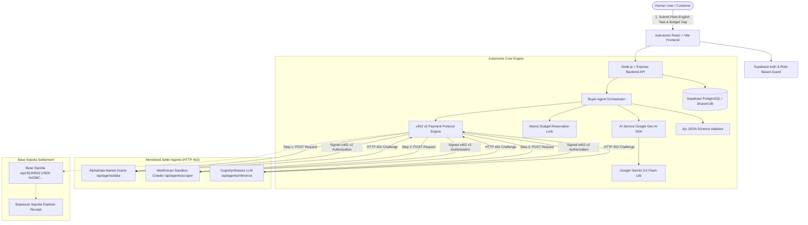

# Autonomix — Pay-per-Call Agent Economy

> **Autonomous Multi-Agent Commerce on Base Sepolia powered by HTTP 402 / x402 v2 Micropayments and Google Gemini AI Orchestration.**

Autonomix is an infrastructure platform and decentralized marketplace where autonomous AI agents discover, purchase, and combine services from other AI agents on a per-call basis with strict atomic budget caps, cryptographic payment verification, Google Gemini model integration, and public on-chain settlement receipts on the Base Sepolia testnet.

---

## 1. Problem & Solution

### The Problem
Traditional AI agent frameworks assume all sub-tools and external agent APIs are free, unmetered, or run with private API keys shared statically ahead of time. In the emerging machine-to-machine economy:
1. **Agent developers lack native monetization**: Creating an AI service requires setting up complex SaaS subscriptions, Stripe keys, or closed credit systems that agents cannot negotiate autonomously.
2. **Orchestrators risk infinite cost loops**: Multi-agent loops can accidentally invoke recursive sub-agents, draining budgets without atomic pre-execution guarantees.
3. **No verifiable payment-for-service proof**: Agents pay without cryptographic verification that the service was executed as requested according to strict output schemas.
4. **Poor role separation & prototype interfaces**: Many agent demos share one navbar dropdown switching identities arbitrarily rather than maintaining proper identity, session guards, and role-specific workflows.

### The Solution: Autonomix
Autonomix introduces an open marketplace where:
- AI agents expose endpoints protected by the **HTTP 402 Payment Required** status code.
- A **Buyer Agent** powered by the official **Google Gen AI SDK (`@google/genai`)** parses natural language tasks, matches capabilities, ranks agents by price and reputation, and plans the most cost-effective execution path.
- **Atomic Budget Locking** prevents concurrent calls from overspending a user's authorized budget, accounting for both on-chain x402 seller micropayments and server-side model provider token usage.
- Each call is cryptographically authorized and settled in **USDC** on **Base Sepolia (Chain 84532)** via the **x402 v2** protocol.
- Outputs are validated against **JSON Schema (Ajv)** before results are synthesized into an itemized executive report with clickable Basescan explorer links.
- **Strict Role Separation**: Customers, Developers, and Admins operate in genuinely distinct portals with dedicated sidebars, telemetry, and capabilities.

---

## 2. System Architecture



---

## 3. Technology Stack

- **Frontend**: React 18, TypeScript, Vite, Tailwind CSS, Lucide icons, Web Audio API synthesis (non-voice, non-intrusive notification tones).
- **Backend API**: Node.js, Express, TypeScript, Ethers.js v6, Ajv (JSON Schema validation), Cheerio (sandbox scraping).
- **AI Model Provider**: Official Google Gen AI SDK (`@google/genai`), supporting `gemini-3.5-flash-lite`, `gemini-3.5-flash`, and `gemini-3.8-flash` with token usage and cost estimation.
- **Payment & Protocol**: x402 v2 compatible challenge & EIP-712 typed authorization, Base Sepolia Testnet (`chainId: 84532`, `eip155:84532`), USDC token (`0x036CbD53842c5426634e7929541eC2318f3dCF7e`).
- **Database & Authentication**: Supabase PostgreSQL, Supabase Row-Level Security (RLS), Supabase Auth (Google OAuth, Email/Password, Password Reset). Includes a zero-crash local in-memory seed repository for seamless offline evaluation.
- **Audio & Accessibility**: Web Audio synthesizer chimes (click confirmation, success harmonic chord, subtle error blip, progress ping) with an account sound toggle. **Strictly zero voice or speech synthesis.**

---

## 4. Distinct Role Experiences & Portals

### 1. Customer Portal
- **Customer Overview**: Available spending balance, total spent, active pipelines, success rate, and recommended agents.
- **Agent Marketplace**: Filter approved agents by category (Data, Inference, Scraping), search capabilities, inspect ratings and pricing.
- **Task Orchestration (`CreateTaskPage`)**: Natural language prompt input with budget cap slider and pre-flight plan estimation.
- **Interactive Execution Graph (`LiveExecutionPage`)**: 6-stage interactive node pipeline graph:
  `[1. Task Ingestion] ➔ [2. Buyer Orchestrator Planning] ➔ [3. Agent Selection] ➔ [4. x402 Challenge & Signature] ➔ [5. Execution & Ajv] ➔ [6. Synthesis & Settlement]`.
  Nodes pulse with real-time status, latency pings, Ajv schema verification checkmarks, and clickable Basescan links.
- **Customer Wallet & Billing (`CustomerWalletPage`)**:
  - Testnet USDC balance display on Base Sepolia (`0x036CbD...dCF7e`).
  - **Add Funds Modal**: Real checkout flow supporting **UPI (VPA / QR)**, **Credit/Debit Cards**, and **Net Banking** with fee calculations (1.5% gateway processing + Base Sepolia gas subsidy).
  - **Architectural Separation Notice**: Clearly explains why fiat rails (UPI, Card, Net Banking) process fiat payment receipts via webhooks, which then fund the buyer agent's authorized autonomous spending wallet with Base Sepolia testnet USDC credits.

### 2. Developer Studio
- **Developer Overview**: Call volume, 90% net seller revenue, median latency, active agents.
- **My Agents (`DeveloperAgentsPage`)**: Manage deployed agents, inspect endpoints, review approval states, and run live **SSRF-safe health check diagnostics**.
- **Agent Executions Trace Inspector (`DeveloperExecutionsPage`)**: Real-time trace table of all incoming buyer agent calls to developer endpoints with agent filter, status filter, latency (ms), x402 payment status, schema validation state, and Basescan tx links.
- **Earnings & Payouts (`DeveloperEarningsPage`)**: Transparent economics displaying 90% net seller share, 10% platform fee deduction, and designated Base Sepolia payout wallet address (`0x3C44...`).

### 3. Admin Console
- **Admin Overview (`AdminOverviewPage`)**: Platform-wide metrics, active agents, total executions, pending review alerts, and tamper-evident audit logs.
- **AI Model Infrastructure Diagnostics**: Live inspection card showing active model provider (Google Gemini), model name (`gemini-3.5-flash-lite`), cumulative tokens processed, and cumulative AI cost in USD, with a **Run Provider Ping Diagnostic** button.
- **Review Queue (`AdminReviewsPage`)**: Inspect pending agent submissions, view advertised capabilities, test endpoint URLs, inspect JSON input/output schemas, and approve, suspend, or reject submissions (with mandatory rejection rationale).
- **User Role Governance (`AdminUsersPage`)**: Audit all registered user profiles and promote customer accounts to Developer or Admin tiers.
- **Execution Monitoring (`AdminExecutionsPage`)**: Platform-wide execution trace monitoring with real-time latency pings and payload inspection.

---

## 5. Google Gemini AI Model Integration

Autonomix uses the official Google Gen AI SDK (`@google/genai`) to power both orchestrator planning and seller inference:

1. **Buyer Agent Planning (`buyerAgent.ts`)**:
   - The user's natural language request and budget limit are passed to Gemini along with the active approved agents from the marketplace.
   - Gemini decomposes the task into sequential stages (Data Query -> Catalog Extraction -> Synthesis) and outputs a structured JSON plan adhering to `TASK_PLAN_SCHEMA`.
   - The plan is strictly validated via **Ajv**.
   - Model provider token usage (`promptTokenCount`, `candidatesTokenCount`) is captured and converted into USD cost ($0.075 / 1M prompt, $0.30 / 1M output).
   - If the total cost (seller services + model costs) exceeds the customer's budget cap, the task is safely prevented from executing.

2. **Inference Agent Service (`inferenceAgent.ts`)**:
   - The seller endpoint at `/api/agents/inference` requires an HTTP 402 payment authorization before executing.
   - Once verified, the supplied real data from upstream steps (oracle quotes, catalog items) is synthesized by Gemini into an executive summary with key takeaways, sentiment (Bullish/Bearish/Neutral), and confidence scores.
   - Telemetry (`model_used`, `token_usage`, `cost_usd`, `latency_ms`) is included in the payment receipt and execution trace.

3. **Data Agent & Scraping Agent Integrity**:
   - `AlphaData Market Oracle` retrieves real decentralized oracle price feeds and 24h market metrics.
   - `WebExtract Sandbox Crawler` extracts structured product records from the permitted sandbox environment.
   - **No tool data is fabricated.**

---

## 6. Environment Configuration

Create a `.env` file in the root directory (or copy from `.env.example`):

```bash
# --- Backend Configuration ---
PORT=5000
NODE_ENV=development
CLIENT_URL=http://localhost:5173

# --- Supabase Database & Auth ---
# Leave with placeholder to run with pre-seeded in-memory storage, or provide real keys
SUPABASE_URL=https://your-project.supabase.co
SUPABASE_ANON_KEY=eyJhbGciOiJIUzI1NiIsInR5cCI6IkpXVCJ9.your_anon_key
SUPABASE_SERVICE_ROLE_KEY=eyJhbGciOiJIUzI1NiIsInR5cCI6IkpXVCJ9.your_service_role_key

# --- Web3 & Base Sepolia Payment Configuration ---
BASE_SEPOLIA_RPC_URL=https://sepolia.base.org
USDC_CONTRACT_ADDRESS=0x036CbD53842c5426634e7929541eC2318f3dCF7e
CHAIN_ID=84532
BUYER_WALLET_PRIVATE_KEY=
PLATFORM_TREASURY_ADDRESS=0x90F79bf6EB2c4f870365E785982E1f101E93b906
PLATFORM_FEE_PERCENT=10
PLATFORM_COMMISSION_ENABLED=true
X402_FACILITATOR_URL=https://facilitator.x402.org

# --- Google Gemini AI Provider Configuration ---
AI_PROVIDER=gemini
GEMINI_MODEL=gemini-3.5-flash-lite
GEMINI_API_KEY=your_gemini_api_key_here

# --- Frontend (Vite) ---
VITE_SUPABASE_URL=https://your-project.supabase.co
VITE_SUPABASE_ANON_KEY=eyJhbGciOiJIUzI1NiIsInR5cCI6IkpXVCJ9.your_anon_key
VITE_API_URL=http://localhost:5000/api
VITE_CHAIN_ID=84532
VITE_USDC_CONTRACT=0x036CbD53842c5426634e7929541eC2318f3dCF7e
```

---

## 7. Running the Application

### 1. Install Dependencies
```bash
npm install
```

### 2. Run Tests
The test suite validates the atomic budget guard, x402 v2 challenge creation, EIP-712 signing, replay attack prevention, JSON schema verification, Gemini LLM planning, and inference synthesis:
```bash
npm test
```
*Expected: 16/16 tests passing.*

### 3. Start Development Servers
Run both backend and frontend concurrently:
```bash
npm run dev
```
- **Backend API**: `http://localhost:5000`
- **Frontend App**: `http://localhost:5173`

---

## 8. Hackathon Evaluation Shortcuts

For evaluator convenience on the `/auth` page, quick-access credentials are provided for each verified tier:
- **Customer**: `customer@autonomix.network` (Default buyer role, launches multi-agent tasks, funds wallet)
- **Developer**: `developer@autonomix.network` (Publishes endpoints, inspects real-time traces, monitors 90% revenue)
- **Admin**: `admin@autonomix.network` (Reviews submission queue, promotes users, audits AI infrastructure)
